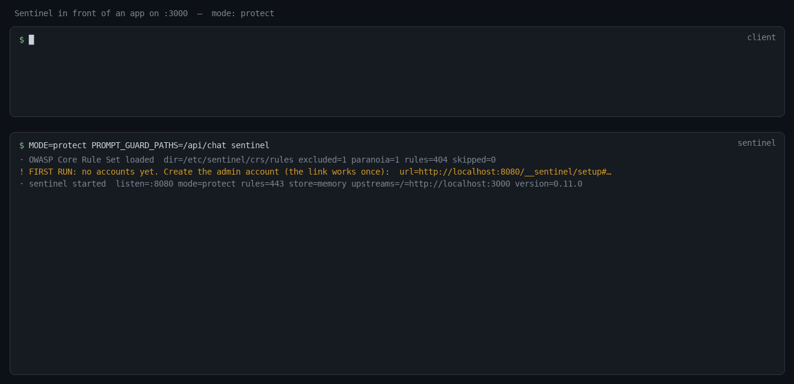
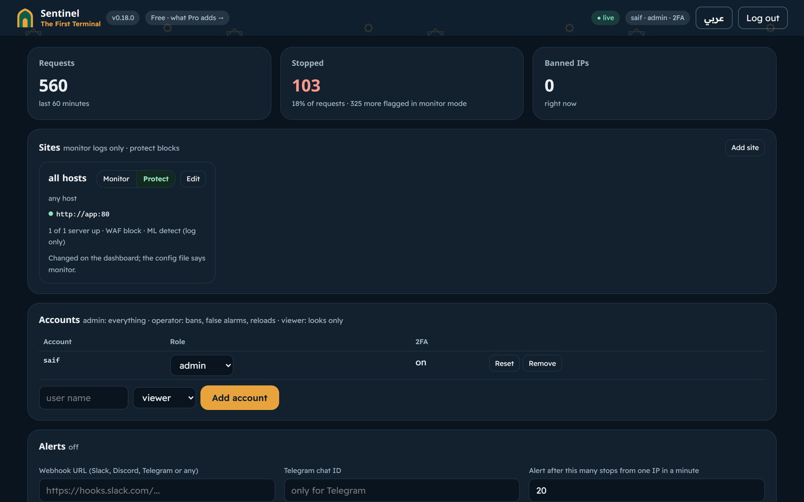
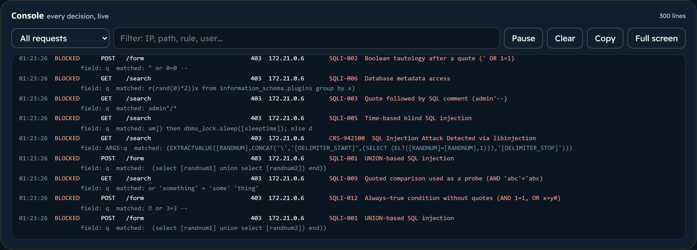

# Sentinel

**A security gateway for web apps, APIs and AI endpoints that explains every decision.**

[](https://github.com/tsxmamii/sentinel/actions/workflows/ci.yml)
[](https://github.com/tsxmamii/sentinel/releases)
[](LICENSE.md)

Sentinel sits in front of your app as a reverse proxy and checks every request
before it gets through: attacks (its own rules, the OWASP Core Rule Set and a
machine-learning model), abuse (rate limits, honeypots, password spraying),
and prompt injection on AI endpoints. It's one Go binary, and it starts in
**monitor mode**, so you can see what it would block before it blocks
anything.







## Why Sentinel

- **Every decision is explained.** Each request gets one log line with what
  was decided, which rule fired, on which field, and the text it matched. The
  ML model says which words pushed its score (`"pg_sleep" +4.89`).
- **Three layers of attack detection.** Sentinel's own rules decode
  evasions first (URL, HTML and Unicode encodings, SQL comments, fullwidth
  letters). The OWASP Core Rule Set runs in a built-in engine that passes
  **99.3%** of CRS's own regression suite. An ML model catches what no rule
  was written for. Together they caught **99.8%** of the attacks and evasion
  variants in our tests, with no normal input wrongly blocked: when only the
  Core Rule Set fires on something the model is sure is harmless, it is
  logged instead of blocked ([benchmarks](docs/benchmarks.md)).
- **Protection for AI endpoints.** A prompt-injection guard normalises
  look-alike letters, spacing and base64 tricks. A canary check withholds any
  reply that leaks your hidden prompt, even reversed or encoded.
- **Safe to switch on, easy to tune.** Monitor mode logs "would block" and
  blocks nothing. When something legitimate is stopped, click **Allow…** on
  the dashboard: the rule is switched off for that path and field only.
  Profiles for WordPress, Laravel, Django, Next.js and AI apps start you
  with the right settings. Rules reload without a restart, and a typo in the
  config stops startup and names the setting.
- **Watches what goes out, too.** Database errors, stack traces, private
  keys and directory listings in your app's responses are withheld; card
  numbers are masked to the last four digits.
- **Beyond attack payloads.** Virtual patches for well-known exploited CVEs
  (Log4Shell, Spring4Shell, Confluence, Struts, PHP-CGI...), attack-tool
  blocking, and an optional proof-of-work browser check for bots.
- **Ready to operate.** Automatic HTTPS (Let's Encrypt), Prometheus
  metrics with a Grafana dashboard, and alerts to Slack, Discord or
  Telegram for honeypot hits, attack bursts and password guessing.
- **Checks your API's shape.** Give it your OpenAPI spec and requests with
  unknown fields, wrong types or extra parameters are refused before they
  reach your code.
- **Fast and small.** Sentinel's own checks (rules + ML) add under **1 ms**
  per request, and CRS about 1.2 ms more, even on a 2-core laptop
  ([benchmarks](docs/benchmarks.md)). The image is a single static binary
  with no shell.

## How it compares

|  | Sentinel | ModSecurity + CRS | Coraza + CRS | Cloud WAF (free plans) |
|---|---|---|---|---|
| Runs on your own server, traffic stays with you | ✅ | ✅ | ✅ | ❌ |
| OWASP Core Rule Set | ✅ built in | ✅ | ✅ | limited |
| ML model for attacks no rule describes | ✅ | ❌ | ❌ | paid plans |
| Prompt-injection guard for AI endpoints | ✅ | ❌ | ❌ | paid plans |
| Dashboard with one-click false-alarm fixes | ✅ | ❌ (logs) | ❌ (logs) | ✅ |
| Each decision explained (rule, field, matched text) | ✅ | partly, in audit logs | partly, in audit logs | partly |
| Rate limits, bans, honeypots, bot check | ✅ | via other modules | via other modules | ✅ |
| Install | one binary or image | web server module | Go library / Caddy, Envoy plugins | DNS change |

ModSecurity and Coraza are rule engines you build a WAF from; Sentinel is a
complete gateway that uses the same Core Rule Set.

## Quickstart

### Docker (one command)

Put Sentinel in front of an app running on port 3000 of your machine:

```bash
docker run --rm -it -p 8080:8080 -v sentinel-data:/var/lib/sentinel \
  -e UPSTREAM_URL=http://host.docker.internal:3000 \
  --add-host=host.docker.internal:host-gateway \
  ghcr.io/tsxmamii/sentinel
```

Open http://localhost:8080 as usual. Now send an attack and watch Sentinel's
terminal:

```bash
curl "http://localhost:8080/?id=1'%20UNION%20SELECT%20password%20FROM%20users--"
```

```
14:02:11  ! DETECTED    GET    /                                  200  SQLI-001  UNION-based SQL injection
                        field: id  matched: 1' union select password from users
```

It says `DETECTED` and the request went through, because Sentinel starts in
monitor mode. When the log looks right for your traffic, add `-e MODE=protect`
and the same request gets a `403`.

**The dashboard.** On the first start Sentinel prints a one-time link
(`FIRST RUN: ... /__sentinel/setup#...`). Open it, choose an admin
password, then log in at http://localhost:8080/__sentinel/dashboard and scan
the QR code with an authenticator app. You'll see every decision live in its
**Console**, with an **Allow…** button for false alarms, each site's servers and
mode (switch a site between monitor and protect with one click), and a
searchable history that survives restarts. To keep the
dashboard off the public port, give it its own: `-e DASHBOARD_ADDR=:9000
-p 9000:9000`, then open http://localhost:9000. The account, the exclusions and the secret
key are kept in the `sentinel-data` volume, so they survive restarts.

### Linux server (one line)

```bash
curl -fsSL https://raw.githubusercontent.com/tsxmamii/sentinel/main/deploy/install.sh | sudo UPSTREAM=http://localhost:3000 sh
```

It installs the latest release as a systemd service, after checking its
checksum (and its signature, if `cosign` is installed), and prints the link to
create the admin account. Run it again to update. Config:
`/etc/sentinel/sentinel.yaml`. Read the script first if you like:
[`deploy/install.sh`](deploy/install.sh).

### Binary

Download a binary for Linux, macOS or Windows from the
[releases](https://github.com/tsxmamii/sentinel/releases), then:

```bash
sentinel init            # writes a commented sentinel.yaml
# set `upstream:` in it, then
sentinel
```

The binary has Sentinel's rules and ML built in. For the OWASP Core Rule Set,
point `waf.crs` at a CRS `rules/` folder (the Docker image includes it).

### Kubernetes

```bash
helm install sentinel ./deploy/helm/sentinel --set config.upstream=http://my-app:3000
```

Point your Ingress at the `sentinel` Service. The chart runs two replicas
with a read-only filesystem, no Linux capabilities and health probes. See
[`deploy/helm/sentinel/values.yaml`](deploy/helm/sentinel/values.yaml).

## What it checks

```
request ─► banned IP? ─► country? ─► honeypot? ─► bots ─► size ─► rate limit ─► API schema
        ─► prompt injection ─► WAF + CRS ─► ML ─► app profile ─► your app
```

Cheap checks run first: a banned IP is refused before any regex runs. Each
check is described in [`docs/architecture.md`](docs/architecture.md).

## Configuration

Everything can go in `sentinel.yaml` or in environment variables (which win):

```yaml
mode: protect
profile: wordpress               # or laravel, django, nextjs, ai
upstream: http://app:3000
waf:
  crs_paranoia: 1        # 1-4: how strict the Core Rule Set is
ml:
  mode: block
rate_limits:
  /api/login: 10/1m
  /: 600/1m
prompt_guard:
  paths: [/api/chat]
redis_url: redis://redis:6379   # share bans and limits between instances
```

Every setting is in [`docs/configuration.md`](docs/configuration.md).
`sentinel check-config` validates a file without starting.

## Going to production

1. **Start in monitor mode** (the default) and read what would be blocked for a
   few days. Switch off a CRS rule that misfires with `waf.crs_exclude`.
2. **Tell Sentinel about your load balancer** (`trusted_proxies`), so it sees
   real client IPs and nobody can fake theirs.
3. **Run more than one instance with Redis** (`redis_url`), so bans and rate
   limits are shared.
4. **Switch to `mode: protect`.**

## Commands

| Command | What it does |
|---|---|
| `sentinel` | Run the gateway (`kill -HUP` reloads rules and exclusions) |
| `sentinel init` | Write a commented config file |
| `sentinel check-config` | Validate a config file |
| `sentinel explain "<text>"` | Show which rules and ML features an input triggers |
| `sentinel bench` | Measure detection and speed on your machine |
| `sentinel watch <log>` | Live, readable view of a log file |

## Evidence

- [Benchmarks](docs/benchmarks.md): detection per layer, latency, throughput, CRS compatibility.
- [Evaluation with real attack tools](docs/evaluation.md): sqlmap found a bypass during development, which was fixed.
- [OWASP ASVS 4.0.3 mapping](docs/asvs.md), requirement by requirement, gaps included.
- [ML report](docs/ml-report.md): how the model was trained and tested, and its limits.
- [Supply chain](docs/supply-chain.md): every release ships with an SBOM, is scanned for known vulnerabilities, and is signed once the repository is public.
- [Changelog](CHANGELOG.md).

## Try the demo lab

`bash lab/start.sh` runs Sentinel in front of OWASP Juice Shop and sends five
attacks with and without it, while you watch the dashboard. See
[`lab/README.md`](lab/README.md). To run Sentinel in front of your own app,
see [`deploy/`](deploy/README.md).

## Development

```bash
cd gateway
go test ./...                       # TEST_DATABASE_URL / TEST_REDIS_URL add PostgreSQL / Redis tests
CRS_TEST_DIR=/path/to/coreruleset/rules go test ./internal/crs/   # CRS regression suite
go run ./cmd/mltrain                # retrain the model (same seeds, same model)
```

Dependencies are vendored, so builds need no network. CI runs formatting,
vet, all tests, the CRS suite, fuzzing of every parser, the Helm chart and a
real-container smoke test on every push ([`ci.yml`](.github/workflows/ci.yml)). Pushing a version tag
publishes binaries and a multi-arch image ([`release.yml`](.github/workflows/release.yml)).

## Getting help

- Questions, bugs and false alarms: [GitHub issues](https://github.com/tsxmamii/sentinel/issues/new/choose).
- Security problems: privately, as described in [`SECURITY.md`](SECURITY.md).
- Code review is welcome; code contributions are not accepted: [`CONTRIBUTING.md`](CONTRIBUTING.md).

## Editions

This repository is **Sentinel Free**: everything above, for any number of
gateways, in production, at no cost.

**Sentinel Pro** (coming) adds zero-trust access for your apps (logins with
2FA, role- and attribute-based access rules, mTLS for services, risk-based
step-up and a tamper-evident audit log), faster rule and virtual-patch
updates for new CVEs, and help with installation, tuning and support.

## License

Sentinel is source-available under the [PolyForm Shield License 1.0.0](LICENSE.md):
you may use it for any purpose, including in production and in your
business, except to provide a product or service that competes with
Sentinel. Third-party components keep their own licenses
([`THIRD_PARTY_LICENSES.md`](THIRD_PARTY_LICENSES.md)).

Copyright 2026 Saif Zahid.
