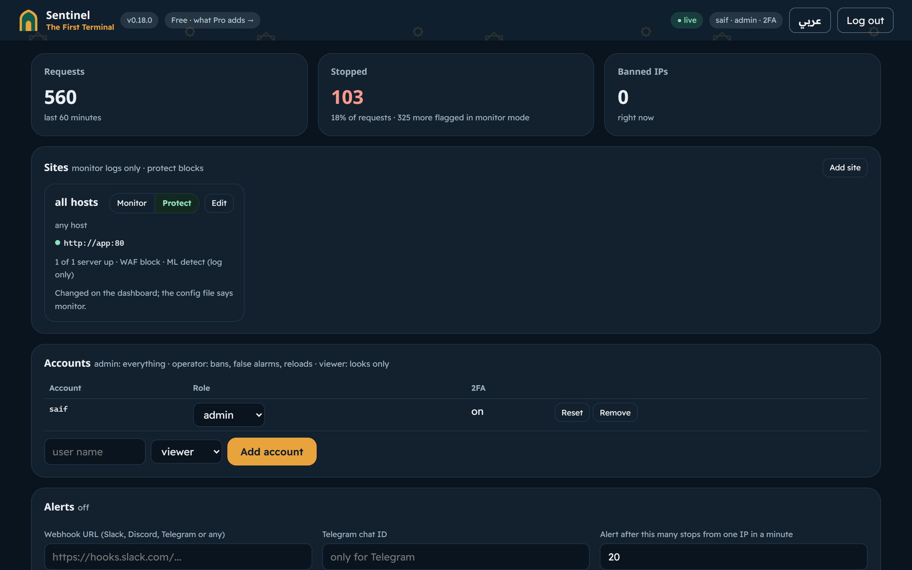

# دليل Sentinel
{: .no_toc }

[English](../guide.html)

Sentinel بوابة حماية لتطبيقات الويب، والـ API، ونقاط الذكاء الاصطناعي. يگعد قدّام تطبيقك، ويفحص كل طلب (بقواعده الخاصة، وقواعد OWASP Core Rule Set، ونموذج تعلم آلي، ويا حدود الطلبات، والفخاخ، وحماية من حقن الأوامر)، ويشرح سبب كل قرار. يبدأ بوضع المراقبة، فتشوف شنو راح يحجب قبل ما يحجب أي شي.



## جربه

على جهازك (Docker)، وتطبيقك على المنفذ 3000:

```bash
docker run --rm -it -p 8080:8080 -v sentinel-data:/var/lib/sentinel \
  -e UPSTREAM_URL=http://host.docker.internal:3000 \
  --add-host=host.docker.internal:host-gateway \
  ghcr.io/thefirstterminal/sentinel
```

بعدين افتح رابط `FIRST RUN` اللي يطبعه، وسوّي حساب المدير. على سيرفر Linux:

```bash
curl -fsSL https://raw.githubusercontent.com/TheFirstTerminal/sentinel/main/deploy/install.sh | sudo sh
```

أو نزّل الملف لنظامك من [صفحة التنزيل](download.html).

## الصفحات

| الصفحة | لمن | شنو بيها |
|---|---|---|
| [طرق التركيب](setups.html) | اللي يركّب Sentinel | ورا Nginx، ورا Cloudflare، على Kubernetes، أو مباشرة على الإنترنت؛ وشلون تتأكد يشتغل |
| [الإعدادات](configuration.html) | اللي يشغّل Sentinel | كل الإعدادات |
| [المجاني والـ Pro](pro.html) | الكل | الفرق بين النسختين، والسعر، وشلون تشتري |
| [الاختبارات](../benchmarks.html) (بالإنكليزي) | الكل | نسبة الكشف، والاختبار المختوم، والسرعة |
| [تقرير التعلم الآلي](../ml-report.html) (بالإنكليزي) | الكل | شگد زين النموذج، وأمثلة على شرحه |
| [التقييم](../evaluation.html) (بالإنكليزي) | الكل | مهاجمة المختبر من برا وشنو طلع |
| [OWASP ASVS](../asvs.html) (بالإنكليزي) | الكل | Sentinel مقابل معيار ASVS 4.0.3، ويا النواقص |
| [سلسلة التوريد](../supply-chain.html) (بالإنكليزي) | اللي ينزّل أو ينشر | SBOM، فحص الثغرات، التواقيع، وشلون تتحقق من الملف |

## التحديث

- **Docker:** `docker pull ghcr.io/thefirstterminal/sentinel` وشغّل الحاوية من جديد. حسابك، والاستثناءات، والسجل كلها بـ `sentinel-data`.
- **سكربت Linux:** شغّل نفس الأمر مرة ثانية.
- **حزمة Debian/Ubuntu أو Fedora/RHEL:** نصّب الحزمة الجديدة فوگ القديمة.
- **Homebrew:** `brew upgrade sentinel`.
- **Pro:** نزّل النسخة الجديدة من [صفحة التنزيل](download.html#pro) بمفتاح ترخيصك.

شنو تغيّر: [CHANGELOG](https://github.com/TheFirstTerminal/sentinel/blob/main/CHANGELOG.md). أسئلة ومشاكل: [GitHub issues](https://github.com/TheFirstTerminal/sentinel/issues). المشاكل الأمنية: شوف [SECURITY.md](https://github.com/TheFirstTerminal/sentinel/blob/main/SECURITY.md)، مو issue عام.
