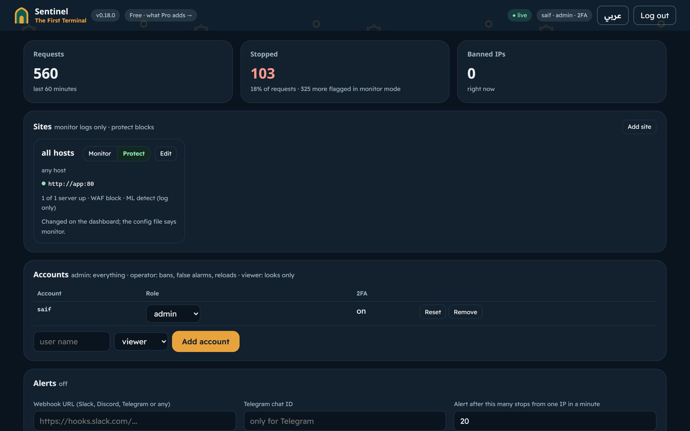

# Sentinel documents

[عربي](ar/guide.html)

Sentinel is a security gateway for web apps, APIs and AI endpoints. It sits
in front of your app, checks every request (its own rules, the OWASP Core
Rule Set and an ML model, plus rate limits, honeypots and a prompt-injection
guard) and explains each decision. It starts in monitor mode, so you see what
it would block before it blocks anything.

**Try it:** `docker run --rm -it -p 8080:8080 -v sentinel-data:/var/lib/sentinel -e UPSTREAM_URL=http://host.docker.internal:3000 --add-host=host.docker.internal:host-gateway ghcr.io/thefirstterminal/sentinel`,
then open the `FIRST RUN` link it prints. On a Linux server:
`curl -fsSL https://raw.githubusercontent.com/TheFirstTerminal/sentinel/main/deploy/install.sh | sudo sh`.
More in the [README on GitHub](https://github.com/TheFirstTerminal/sentinel#quickstart).

The guide for each version lives here, next to its code, and is updated
with every release.

| File | For | What it is |
|---|---|---|
| [`setups.md`](setups.md) | Whoever installs Sentinel | Behind Nginx, behind Cloudflare, on Kubernetes, directly on the internet; and how to check it works |
| [`configuration.md`](configuration.md) | Whoever runs Sentinel | Every setting |
| [`pro.md`](pro.md) | Everyone | Sentinel Free and Sentinel Pro compared, and Pro's price |
| [`benchmarks.md`](benchmarks.md) | Everyone | Detection per layer (including CSIC 2010), speed |
| [`ml-report.md`](ml-report.md) | Everyone | How well the ML classifier does: test data, evasion test, example explanations |
| [`evaluation.md`](evaluation.md) | Everyone | Attacking the lab from outside (replay, overhead, sqlmap) and what it found |
| [`asvs.md`](asvs.md) | Everyone | Sentinel mapped to OWASP ASVS 4.0.3, including the gaps |
| [`supply-chain.md`](supply-chain.md) | Whoever releases or installs Sentinel | SBOM, vulnerability scans, signatures, how to verify |
| [`../SECURITY.md`](https://github.com/TheFirstTerminal/sentinel/blob/main/SECURITY.md) | Everyone | How to report a security problem privately |

## Updating

- **Docker:** `docker pull ghcr.io/thefirstterminal/sentinel` and start the container again. Your account, exclusions and history are in the `sentinel-data` volume.
- **Linux install script:** run the same one-line command again.
- **Debian/Ubuntu or Fedora/RHEL package:** install the new package over the old one.
- **Homebrew:** `brew upgrade sentinel`.
- **The demo lab in a clone of this repository:** `bash lab/update.sh`.

See [`CHANGELOG.md`](https://github.com/TheFirstTerminal/sentinel/blob/main/CHANGELOG.md) for what changed. Questions and bug reports: [GitHub issues](https://github.com/TheFirstTerminal/sentinel/issues).
Security problems: see [`SECURITY.md`](https://github.com/TheFirstTerminal/sentinel/blob/main/SECURITY.md), not a public issue.
